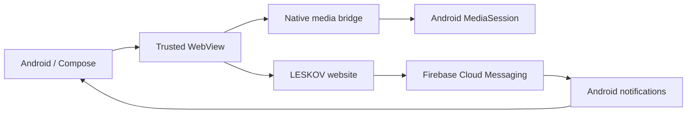

<div align="center">
  
  <h1>LESKOV · Android</h1>
  <p><strong>Music. Community. Conversation.</strong></p>
  <p>Музыка, сцена и личная история в одном современном пространстве.</p>

  [](https://github.com/leskov-official/leskov-android/actions/workflows/android.yml)
  [](https://developer.android.com/about/versions/oreo)
  [](https://kotlinlang.org/)
  [](https://github.com/leskov-official/leskov-android/releases)

  **[Official website](https://lesv.online/) · [Download](https://lesv.online/install.php) · [Releases](https://github.com/leskov-official/leskov-android/releases) · [Support](mailto:info@lesv.info)**
</div>

---

Official Android client for [LESKOV](https://lesv.online/), a platform for artists and their communities. Discover content, listen to music and keep in touch in one app. The Android client integrates the website with native navigation, media controls, file selection and notifications.

> **Release status:** 3.4.9 / versionCode 17 is a release candidate. Build, signing, security review and real-device acceptance are required before distribution. Debug APKs are for testing only.

**[Experience](#experience) · [What's new](#whats-new-in-349) · [Installation](#download-and-install) · [Developers](#developer-setup) · [Release workflow](#maintainer-release-workflow) · [Security](#security-and-privacy) · [Documentation](#документация--documentation)**

## Experience

| Feature | Description |
|---|---|
| Music & media | Website-owned playback with Android MediaSession, track artwork and background controls |
| Community | Feed, search, profiles and artist content |
| Conversations | Messages, photos, attachments, voice messages and video calls where available |
| Notifications | FCM integration, deep links to conversations, sender avatars when available; OS privacy settings apply |
| Personalization | Light, dark and seasonal website themes; native guest navigation |
| Languages | Русский · Eesti · English |

## Platform

| Requirement | Details |
|---|---|
| Android | 8.0+ (API 26) |
| Compile / target SDK | 36 |
| Application ID | `com.aistudio.leskov.musix` |
| Version | 3.4.9 / versionCode 17 |
| Architecture | Kotlin · Jetpack Compose · WebView · MediaSession · FCM |



## What's new in 3.4.9

- One native-only winter control position for all pages, guest and signed-in modes; the holiday control gets a separate non-overlapping slot when visible.
- Shared dark Pause ink for the site's regular video players, video circles and Search/Discover catalog player; also covers system theme when it is dark. Requires the matching 3.4.9 server CSS patch for browsers.
- Density-independent LESKOV monogram for media, push and Firebase default notification icons. SystemUI chooses tint and size. The original owner-supplied festive logo is retained byte-for-byte as the app and round icon.
- Existing attachment, messaging, logout, signing and security rules are retained.

See the [3.4.9 acceptance notes](docs/ANDROID_3_4_9_RU.md). The previous APK's VirusTotal result and OSV report do not certify a new binary. Android and OEM launchers may mask the app icon or use cached icons temporarily; the status bar is monochrome by design.

## Для пользователей / For users

LESKOV объединяет музыку, публикации, общение и персональный профиль. Устанавливайте только проверенный подписанный APK с официальной страницы. Обновление должно сохранять существующую учётную запись и данные приложения; это необходимо подтвердить на устройстве до публикации.

## Download and install

- Official website: [lesv.online/install.php](https://lesv.online/install.php)
- Official repository: [leskov-official/leskov-android](https://github.com/leskov-official/leskov-android)
- Published builds: [GitHub Releases](https://github.com/leskov-official/leskov-android/releases), when available.

Use only a verified signed release APK. Compare the SHA-256 checksum with the release notes. Keep Google Play Protect enabled. If installation is blocked as harmful, stop and contact the developer. The web app is available as an alternative.

## Previous release · 3.4.8

- Independent thread scrolling, attachment width constraints, Android photo picker and attachment reset. See [3.4.8 acceptance](docs/ANDROID_3_4_8_RU.md).

### 3.4.7

- Website-native messenger layout, direct message routing, sender previews, registered-device notification center, and multi-photo handling. Requires the matching backend patch. See [3.4.7 acceptance](docs/ANDROID_3_4_7_RU.md).

## Inherited 3.4.4 improvements

- Attachment selections now require a resolvable external content provider and an explicit temporary read grant. App-owned and same-UID providers, non-content URIs and invalid multi-file selections are rejected. A result from a navigated-away document is discarded.
- Cloud backup and Android device-to-device transfer exclude app-private storage, preferences, databases and WebView session state.
- Firebase configuration preflight validates the matching Android client, project number, app ID and key format without printing credentials. Token failures clear cached readiness; successful device registration is not proof of actual push delivery.
- The signed workflow checks resolved Maven runtime modules against OSV before signing, verifies both APK and AAB signing identities, and uses updated Node 24 Actions. The OSV audit is a known-advisory check, not an antivirus scan.
- Dialog layout improvements from 3.4.3 are retained and regression-tested at narrow and IME-reduced viewports.

### Retained 3.4.3 improvements

- The messenger follows the site’s responsive layout; native constraints limit horizontal overflow and allow the message thread to scroll independently.
- The native bottom bar hides for the keyboard; the WebView accounts for IME and system insets.
- The app keeps its existing package, scoped first-party web bridges, TLS checks, session and notification integrations. The site owns music playback; Android MediaSession reflects playback status.
- WebView Safe Browsing remains enabled; file URL access is disabled. File selection is restricted to content URIs on the trusted page. External intent launches from page navigation require a user gesture.
- Signed release candidate workflow verifies the package, version, signing certificate, non-debuggable flag and SHA-256. It does not publish automatically.

## Developer setup

Install JDK 21, Android SDK platform 36, build tools 36.0.0, Gradle 9.3.1, Python 3, Node.js and PHP CLI for the backend fixture tests. The wrapper JAR is not present in this source distribution; use installed Gradle or generate the wrapper with a trusted Gradle installation.

```bash
python3 -m pip install PyYAML playwright
python3 -m playwright install chromium
python3 tools/validate_source.py
python3 tools/test_mobile_backend.py
python3 tools/test_verify_release.py
python3 tools/test_security_release.py
python3 tools/test_dialog_layout.py
python3 tools/test_final_ui.py
gradle --no-daemon :app:assembleDebug :app:testDebugUnitTest :app:lintDebug
```

Debug builds can run without Firebase configuration; push delivery will be unavailable. Full FCM requires a real `app/google-services.json` registered for this package and the existing server integration. See [backend contract](docs/BACKEND_FCM_CONTRACT.md). Do not commit credentials.

## Maintainer release workflow

Use the existing app-signing key for direct APK distribution. Changing the key can prevent existing users from updating. Do not generate a new key merely to get around Play Protect. For Google Play, follow the Play App Signing / upload key requirements separately.

In GitHub repository **Settings → Secrets and variables → Actions**, configure these **Secrets**:

- `FIREBASE_ANDROID_CONFIG_BASE64`: real Firebase Android configuration (base64).
- `SIGNING_KEYSTORE_BASE64`: existing release keystore (base64).
- `STORE_PASSWORD`, `KEY_ALIAS`, `KEY_PASSWORD`: existing signing credentials.

Configure the **Variable** `RELEASE_CERT_SHA256` with the independently known SHA-256 fingerprint of the existing app-signing certificate. Obtain it from a trusted original release or key, not from the candidate you are trying to verify. No secret values belong in the README, commits, logs or chat.

Protect `main`, review workflow changes and restrict write access before running signing jobs. Keep an encrypted offline backup of the existing key.

Run **Actions → LESKOV Android — signed release candidate → Run workflow → main**. Download `LESKOV-3.4.9-signed-candidate` after all steps succeed. It contains a signed APK, AAB, APK and AAB signature reports, package metadata, OSV audit evidence, SHA256SUMS and source commit. Verify locally:

```bash
sha256sum -c SHA256SUMS.txt
apksigner verify --verbose --print-certs LESKOV-3.4.9.apk
```

Do not distribute until [the release acceptance checklist](docs/RELEASE_CHECKLIST_RU.md) passes. If Play Protect blocks a legitimate APK after review, use the [official appeal procedure](https://support.google.com/googleplay/android-developer/contact/protectappeals). Do not instruct users to disable protection. Publish the reviewed APK and its checksum/report to GitHub Releases and the LESKOV admin installation page only after approval of the release by the maintainer.

## Release gates

| Gate | Evidence |
|---|---|
| Source / CI | Review, unit tests, lint, browser regressions |
| Dependencies | OSV report for resolved runtime Maven modules |
| Identity | APK and AAB signing certificates, known trusted fingerprint |
| Integrity | SHA-256 of final artifacts, source commit |
| Device acceptance | Upgrade without data loss, messaging, media and notifications |
| Distribution | Exact APK VirusTotal report, Play Protect enabled, maintainer approval |

## Security and privacy

The Android client uses HTTPS and first-party web messaging. Camera and microphone support calls and recording; notifications support messages and calls; media service supports playback controls. The backend and third-party dependencies are also part of the security review. On release builds, the OSV check sends only public Maven coordinates and versions; it stops signing on known matches or an incomplete check. The separate audit artifact records its result. It does not cover every library, build plugin, native binary or website script. For a Firebase HTTP 400, follow [the diagnostics guide](docs/ANDROID_3_4_4_RU.md) rather than changing the package or signing key. VirusTotal reports must match the exact SHA-256 of the APK being distributed. A signature proves integrity and signing identity, not that the software is malware-free.

Report security issues privately to [info@lesv.info](mailto:info@lesv.info), without including account credentials or private messages. [Privacy policy](https://lesv.online/privacy_policy.php) · [Terms](https://lesv.online/terms.php).

## Документация / Documentation

- [3.4.9: приёмка и изменения (RU)](docs/ANDROID_3_4_9_RU.md)
- [3.4.8: приёмка и изменения (RU)](docs/ANDROID_3_4_8_RU.md)
- [3.4.7: приёмка (RU)](docs/ANDROID_3_4_7_RU.md)

- [3.4.4: безопасность, Firebase и выпуск (RU)](docs/ANDROID_3_4_4_RU.md)
- [3.4.3: предыдущие исправления (RU)](docs/ANDROID_3_4_3_RU.md)
- [Приёмочный тест-план (RU)](docs/RELEASE_CHECKLIST_RU.md)
- [Backend FCM contract](docs/BACKEND_FCM_CONTRACT.md)
